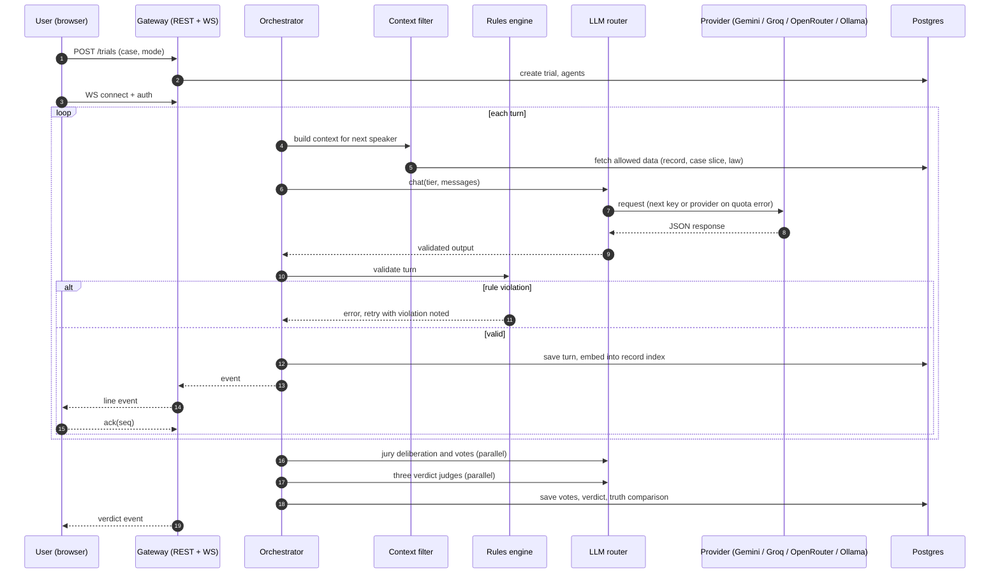

# Architecture: Verdict

Version 0.1 · Based on `PRD.md`.

## 1. Tech stack

Versions are baselines as of November 2026. **Phase 1 task:** check each against its registry, pin the exact patch version in the lockfile, and record the result in `Memory.md`.

| Layer | Choice | Baseline |
|---|---|---|
| Backend language | Python | 3.12 |
| Web framework | FastAPI + Uvicorn | FastAPI 0.115+, Uvicorn 0.30+ |
| Validation | Pydantic | 2.x |
| Orchestration | LangGraph | 1.x |
| HTTP client | httpx | 0.27+ |
| Database | PostgreSQL | 17 |
| Vector search | pgvector | 0.8 |
| ORM and migrations | SQLAlchemy + Alembic | SQLAlchemy 2.0, Alembic 1.x |
| DB driver | psycopg | 3.x |
| Embeddings | BAAI/bge-m3 via sentence-transformers (local, 1024 dims) | 3.x |
| Reranker | BAAI/bge-reranker-v2-m3 (local) | n/a |
| Local LLM fallback | Ollama | latest |
| Frontend language | TypeScript | 5.x |
| Frontend framework | React + Vite | React 19, Vite 7 |
| 3D | three + @react-three/fiber + @react-three/drei | three 0.17x+, fiber 9 |
| Styling | Tailwind CSS | 4.x |
| Client state | Zustand | 5.x |
| Backend tests | pytest + pytest-asyncio, ruff, mypy | latest |
| Frontend tests | Vitest + Testing Library, ESLint | latest |
| Runtime | Node.js | 22 LTS |
| Containers | Docker + Docker Compose | v2 |
| CI | GitHub Actions | n/a |
| Hosting (later) | Free-tier container host + free Postgres with pgvector | verify at deploy time |

## 2. Directory structure

```
verdict/
  PRD.md Architecture.md Rules.md Phases.md Design.md Memory.md TASKS.md
  .env.example                 # all env var names, no real values
  docker-compose.yml           # Postgres + pgvector, (optional) Ollama
  frontend/
    src/
      scene/                   # 3D courtroom, furniture, lights
      characters/              # character components and animation state
      camera/                  # camera director (shot definitions)
      events/                  # WebSocket client, event queue, ack sender
      ui/                      # captions, controls, verdict screen (React)
      store/                   # Zustand stores
      styles/                  # globals.css, design tokens
    tests/
  backend/
    app/
      main.py                  # FastAPI app factory
      config.py                # env loading and settings
      api/                     # REST routers (auth, cases, trials, admin)
      ws/                      # WebSocket endpoint and event schemas
      orchestrator/            # LangGraph graph, states, turn control
      rules/                   # rules engine (pure functions)
      context/                 # context filters: what each role may see
      agents/                  # one module per role: prompts + output schemas
      llm/                     # router, key pools, cooldowns, JSON validation
      rag/                     # ingestion, chunking, retrievers, reranker
      voting/                  # aggregation, thresholds, disagreement
      casegen/                 # case generation and validation
      scoring/                 # compare verdict with ground truth
      db/                      # models, session, migrations
      schemas/                 # Pydantic request and response models
    tests/
      unit/ integration/ isolation/
  data/
    law_corpus/                # cleaned source text, one file per act
    cases/                     # hand-written test cases (JSON)
    eval/                      # retrieval and truth-match test sets
  scripts/                     # ingest_law.py, run_batch.py, check_versions.py
  .github/workflows/ci.yml
```

## 3. Data model (PostgreSQL)

```sql
CREATE EXTENSION IF NOT EXISTS vector;
CREATE EXTENSION IF NOT EXISTS citext;

CREATE TABLE users (
  id uuid PRIMARY KEY DEFAULT gen_random_uuid(),
  email citext UNIQUE,
  password_hash text,
  display_name text NOT NULL,
  is_guest boolean NOT NULL DEFAULT false,
  created_at timestamptz NOT NULL DEFAULT now()
);

CREATE TABLE cases (
  id uuid PRIMARY KEY DEFAULT gen_random_uuid(),
  slug text UNIQUE NOT NULL,
  title text NOT NULL,
  jurisdiction text NOT NULL DEFAULT 'IN',
  charge text NOT NULL,
  difficulty smallint NOT NULL DEFAULT 1,
  truth jsonb NOT NULL,              -- culprit, timeline events, motive
  source text NOT NULL,              -- 'handwritten' | 'generated'
  created_at timestamptz NOT NULL DEFAULT now()
);

CREATE TABLE evidence (
  id uuid PRIMARY KEY DEFAULT gen_random_uuid(),
  case_id uuid NOT NULL REFERENCES cases(id) ON DELETE CASCADE,
  exhibit_no text NOT NULL,
  type text NOT NULL,
  description text NOT NULL,
  admissible boolean NOT NULL,
  reason_inadmissible text
);
CREATE INDEX evidence_case_idx ON evidence(case_id);

CREATE TABLE witnesses (
  id uuid PRIMARY KEY DEFAULT gen_random_uuid(),
  case_id uuid NOT NULL REFERENCES cases(id) ON DELETE CASCADE,
  name text NOT NULL,
  saw_event_ids int[] NOT NULL,      -- indexes into cases.truth.timeline
  reliability numeric(3,2) NOT NULL CHECK (reliability BETWEEN 0 AND 1),
  hides text[] NOT NULL DEFAULT '{}',
  persona jsonb NOT NULL DEFAULT '{}'
);
CREATE INDEX witnesses_case_idx ON witnesses(case_id);

CREATE TABLE trials (
  id uuid PRIMARY KEY DEFAULT gen_random_uuid(),
  case_id uuid NOT NULL REFERENCES cases(id),
  user_id uuid REFERENCES users(id),
  mode text NOT NULL,                -- watch | lawyer | judge | juror
  human_role text,
  state text NOT NULL DEFAULT 'SETUP',
  config jsonb NOT NULL,             -- juror_count, rounds, threshold, hung_band
  started_at timestamptz NOT NULL DEFAULT now(),
  finished_at timestamptz
);
CREATE INDEX trials_user_idx ON trials(user_id);

CREATE TABLE agents (
  id uuid PRIMARY KEY DEFAULT gen_random_uuid(),
  trial_id uuid NOT NULL REFERENCES trials(id) ON DELETE CASCADE,
  role text NOT NULL,                -- judge | prosecutor | defense | witness | defendant | clerk | juror | verdict_judge
  persona jsonb NOT NULL DEFAULT '{}',
  tier text NOT NULL,                -- strong | mid | small
  memory jsonb NOT NULL DEFAULT '[]'
);
CREATE INDEX agents_trial_idx ON agents(trial_id);

CREATE TABLE turns (
  id uuid PRIMARY KEY DEFAULT gen_random_uuid(),
  trial_id uuid NOT NULL REFERENCES trials(id) ON DELETE CASCADE,
  seq int NOT NULL,
  agent_id uuid REFERENCES agents(id),
  speaker_role text NOT NULL,
  text text NOT NULL,
  action text,
  emotion text,
  camera text,
  objection jsonb,
  admitted boolean NOT NULL DEFAULT true,
  struck boolean NOT NULL DEFAULT false,
  created_at timestamptz NOT NULL DEFAULT now(),
  UNIQUE (trial_id, seq)
);

CREATE TABLE turn_embeddings (
  turn_id uuid PRIMARY KEY REFERENCES turns(id) ON DELETE CASCADE,
  trial_id uuid NOT NULL,
  embedding vector(1024) NOT NULL
);
CREATE INDEX turn_emb_trial_idx ON turn_embeddings(trial_id);
CREATE INDEX turn_emb_hnsw ON turn_embeddings USING hnsw (embedding vector_cosine_ops);

CREATE TABLE knowledge_chunks (
  id bigserial PRIMARY KEY,
  domain text NOT NULL,              -- statute | caselaw | philosophy | ethics | logic | procedure ...
  audience text[] NOT NULL,          -- {judge,lawyer,juror}
  act text, section_no text, title text,
  body text NOT NULL,
  ipc_equivalent text,
  valid_from date, valid_to date,
  source text, license text,
  embedding_model text,
  ingested_at timestamptz NOT NULL DEFAULT now(),
  tsv tsvector GENERATED ALWAYS AS (to_tsvector('english', coalesce(title,'') || ' ' || body)) STORED,
  embedding vector(1024) NOT NULL
);
CREATE INDEX kc_hnsw ON knowledge_chunks USING hnsw (embedding vector_cosine_ops);
CREATE INDEX kc_tsv ON knowledge_chunks USING gin (tsv);
CREATE INDEX kc_lookup ON knowledge_chunks (act, section_no);
CREATE INDEX kc_domain ON knowledge_chunks (domain);

CREATE TABLE votes (
  id uuid PRIMARY KEY DEFAULT gen_random_uuid(),
  trial_id uuid NOT NULL REFERENCES trials(id) ON DELETE CASCADE,
  agent_id uuid NOT NULL REFERENCES agents(id),
  kind text NOT NULL,                -- juror_pre | juror_final | judge
  guilty boolean,
  guilt_probability numeric(4,3),
  confidence numeric(4,3),
  reasoning text NOT NULL,
  cited_turn_ids uuid[] NOT NULL DEFAULT '{}',
  cited_chunk_ids bigint[] NOT NULL DEFAULT '{}'
);
CREATE INDEX votes_trial_idx ON votes(trial_id);

CREATE TABLE verdicts (
  trial_id uuid PRIMARY KEY REFERENCES trials(id) ON DELETE CASCADE,
  j numeric(4,3) NOT NULL,
  p numeric(4,3) NOT NULL,
  score numeric(4,3) NOT NULL,
  threshold numeric(4,3) NOT NULL,
  outcome text NOT NULL,             -- guilty | not_guilty | hung
  disagreement numeric(4,3) NOT NULL,
  matches_truth boolean
);

CREATE TABLE llm_calls (
  id bigserial PRIMARY KEY,
  trial_id uuid REFERENCES trials(id) ON DELETE SET NULL,
  agent_role text,
  provider text NOT NULL,
  model text NOT NULL,
  key_alias text NOT NULL,           -- 'gemini#1', never the key itself
  tokens_in int, tokens_out int,
  latency_ms int,
  status text NOT NULL,              -- ok | quota | error | timeout
  created_at timestamptz NOT NULL DEFAULT now()
);
CREATE INDEX llm_calls_trial_idx ON llm_calls(trial_id);
```

## 4. API conventions

- Base path `/api/v1`. WebSocket at `/ws/v1/trials/{trial_id}`.
- JSON in, JSON out, `snake_case` fields, ISO 8601 UTC timestamps, UUID ids.
- Success envelope: `{ "data": <object|array>, "meta": { "request_id": "..." } }`
- Error envelope: `{ "error": { "code": "VALIDATION_ERROR", "message": "...", "details": {} }, "meta": { "request_id": "..." } }`
- Auth header: `Authorization: Bearer <jwt>`. Every response carries `X-Request-ID`.
- WebSocket auth: first client message `{ "type": "auth", "token": "<jwt>" }`; the server closes the socket if it is missing within 5 s.

| Error code | HTTP | Meaning |
|---|---|---|
| `VALIDATION_ERROR` | 422 | Request body or params invalid |
| `UNAUTHENTICATED` | 401 | Missing or invalid token |
| `FORBIDDEN` | 403 | Not allowed for this user |
| `NOT_FOUND` | 404 | Resource does not exist |
| `CONFLICT` | 409 | State conflict (for example trial already started) |
| `RULE_VIOLATION` | 422 | Action breaks courtroom rules |
| `RATE_LIMITED` | 429 | Too many requests |
| `LLM_UNAVAILABLE` | 503 | All providers in the chain exhausted |
| `INTERNAL_ERROR` | 500 | Unexpected failure |

Routes (v1):

```
POST /auth/register | /auth/login | /auth/guest
GET  /cases            GET /cases/{id}        POST /cases/generate   (P1)
POST /trials           GET /trials/{id}       GET  /trials/{id}/turns
GET  /trials/{id}/verdict                     POST /trials/{id}/actions   (human move)
GET  /health           GET /admin/llm-status
```

WebSocket events, server to client: `line`, `ruling`, `state`, `prompt`, `verdict`, `error`. Client to server: `auth`, `ack`, `human_action`, `object`.

```json
{ "type": "line", "seq": 42, "speaker": "defense", "text": "Objection!",
  "action": "point", "emotion": "firm", "camera": "wide", "audio_url": null }
```

## 5. Main user journey



## 6. Architecture decision records

### ADR-1: PostgreSQL with pgvector instead of a dedicated vector database
- **Context:** The law corpus is a few thousand to tens of thousands of chunks. We also need exact section lookups, full-text search and relational data.
- **Decision:** Use PostgreSQL 17 with pgvector for vectors, `tsvector` for keyword search and normal tables for everything else.
- **Consequences:** One service to run and back up; hybrid retrieval in SQL. Less scale headroom than a dedicated vector DB, which we do not need at this size.

### ADR-2: Information isolation enforced by the orchestrator and context filters
- **Context:** The product breaks if a witness knows what they never saw or a juror sees struck testimony.
- **Decision:** Agents never call each other or the database. The orchestrator builds each agent's context through `context/` filters, and jurors can only query `turn_embeddings` with `admitted = true AND struck = false`.
- **Consequences:** Isolation is testable with automated tests. Every new agent needs a filter before it can be added.

### ADR-3: Multi-provider free LLM router with failover
- **Context:** All models must be free, and free tiers have strict, changing quotas. Limits are per project or organisation, not per key.
- **Decision:** One router module calls all providers through OpenAI-compatible endpoints. Chains per tier (strong, mid, small) are set in `.env`. On quota or server errors, the key is put on cooldown and the next key, then provider, then local Ollama is tried.
- **Consequences:** No single provider outage ends a trial. Model output quality varies, so every response is validated with Pydantic and retried once. Extra keys from the same project add no capacity.

### ADR-4: No Redis in v1; live trial state in process memory plus Postgres
- **Context:** v1 is single-instance and solo-developed. Redis adds operational cost.
- **Decision:** Keep running-trial state in the orchestrator process and persist each turn to Postgres immediately.
- **Consequences:** A server restart ends running trials (they can be replayed from stored turns). Horizontal scaling later will require moving live state to Redis.

### ADR-5: Server-authoritative event stream with client acknowledgements
- **Context:** LLM latency is variable and the 3D client needs to play lines in order.
- **Decision:** The server sends one `line` event at a time and waits for the client `ack` (with a timeout) before dispatching the next. Generation of the following turn may start early.
- **Consequences:** No unbounded queue and simple replay. A dead client stalls the trial until the timeout, after which the trial pauses.

## 7. Deployment topology

**Environment variables** (names only, in `.env.example`):

```
DATABASE_URL=
JWT_SECRET=
JWT_EXPIRES_MINUTES=
GEMINI_API_KEYS=
GROQ_API_KEYS=
OPENROUTER_API_KEYS=
OLLAMA_BASE_URL=
CHAIN_STRONG=
CHAIN_MID=
CHAIN_SMALL=
EMBEDDING_MODEL=BAAI/bge-m3
RERANKER_MODEL=BAAI/bge-reranker-v2-m3
CORS_ORIGINS=
LOG_LEVEL=
```

**Local:** `docker compose up` starts Postgres with pgvector (and Ollama if enabled). Backend runs with `uvicorn`, frontend with `vite`.

**CI (GitHub Actions) on every pull request:** ruff and mypy, pytest (unit, integration, isolation), ESLint and `tsc --noEmit`, Vitest, frontend build. Merge is blocked if any step fails.

**Later deploy:** frontend on a free static host, backend as one container on a free-tier host, Postgres with pgvector on a free managed plan (verify availability and limits at deploy time). Embedding and reranker models need memory; if the host is too small, run ingestion offline and ship the prepared index.

**Scaling notes:** The first bottleneck is free-tier LLM quota, not compute. Next is single-process trial state (ADR-4). Cache law retrievals per case and cache generated cases to save quota.
